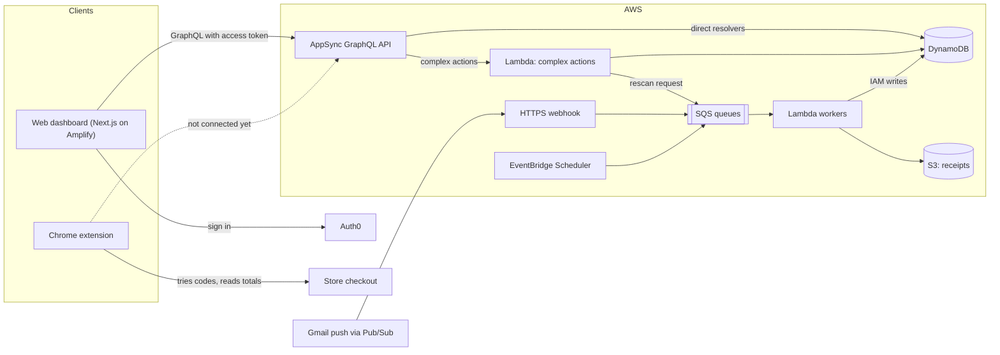
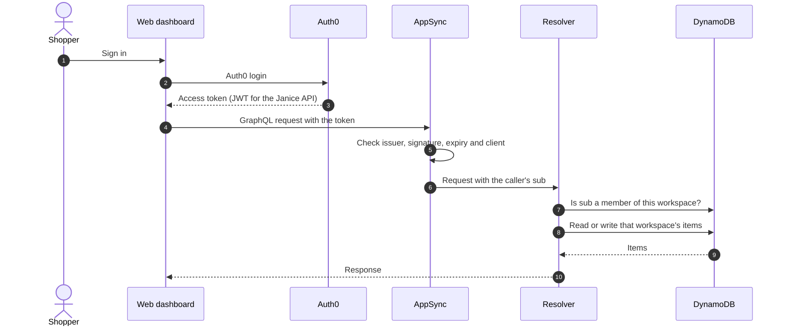
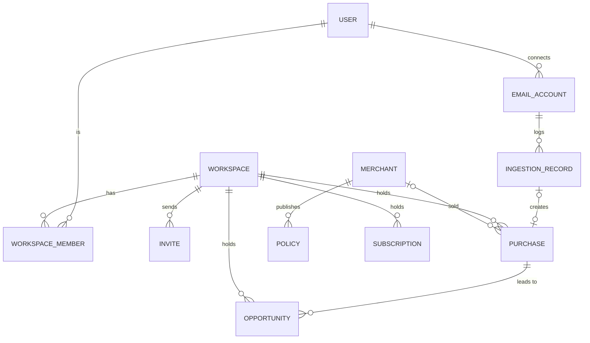
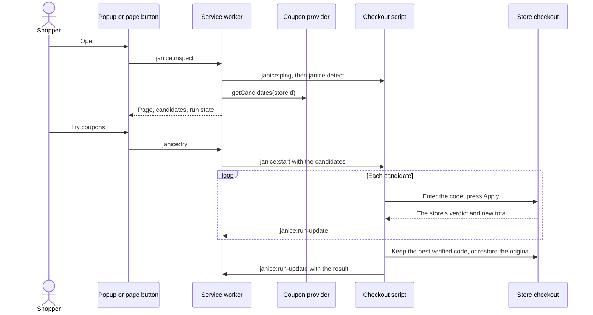

# Janice architecture

How the whole Janice system fits together: the web dashboard, the AppSync GraphQL backend, the background
workers and this Chrome extension. Each part says how far along it is, so people and agents (Claude, Codex)
share the same picture.

- **Snapshot:** October 24, 2026. The code is the source of truth. Update this file when the architecture
  changes; the claude.ai page below is rebuilt from it.
- **States:** **Built** works today · **Drafted** written down or mocked up in a repo, not running for real ·
  **Planned** in the current plan only · **Open** needs a decision · **Not started**.
- **Contracts:** draft HTTP endpoints in [`openapi.yaml`](openapi.yaml); the GraphQL schema is
  `schema.graphql` in the `janice-backend` repo.
- **Agents:** the AGENTS.md files in `janice-extension`, `janice-backend` and `janice-web` all point here.
- **For people:** the same content as a page, [Janice Engineering Docs](https://claude.ai/artifact/T8L6C4d6D2Tg6evhXB1wjH),
  and the work on the [Janice Board](https://claude.ai/artifact/1shuW3C5R8tEU8XWiNDG1C). Both are private
  claude.ai pages, opened by whoever they are shared with.

## What Janice is

Janice helps people keep money they would otherwise lose after buying something, and save at checkout. It reads
order and receipt emails, keeps a record of each purchase, and turns purchases into opportunities that have a
deadline: a price drop, a return window closing, a warranty or subscription about to renew. The Chrome extension
tries coupon codes at checkout and keeps a code only when the store's own total goes down.

The web dashboard is where people see their savings, purchases and open opportunities. Background workers do the
watching: they import receipts, check prices and apply merchant policies without anyone opening the dashboard.

## Where things stand

| Part | Repository | State | What is there |
| --- | --- | --- | --- |
| Chrome extension | `janice-extension` | Built | Version 0.1.0, Manifest V3. Tries coupons on the Sharper Image (US) checkout and cart drawer with local sample coupons (AFF15: $15 off $150). Tips on product pages. 179 unit and 27 browser tests. Not on the Chrome Web Store. |
| Web dashboard | `janice-web` | Drafted | A mocked prototype, not committed yet: plain HTML, CSS and JavaScript with 24 sample products, served by a small Node script. No backend. The plan names Next.js and TypeScript with Tailwind CSS and shadcn/ui, on AWS Amplify Hosting. |
| GraphQL API | `janice-backend` | Drafted | `schema.graphql` models 11 record types with their queries, mutations and subscriptions. Only the user resolvers are mapped, and their code is not in the repo yet. `serverless.yml` was copied from the Loophole and MTC projects and won't deploy as is. |
| Background workers | none yet | Planned | EventBridge Scheduler, SQS and Lambda, as described in the AppSync plan. |
| Marketing site | `janice-marketing` | Built | Astro site with a blog on price drops, return windows, subscription renewals and warranties. |

## System map

The dashboard talks to one GraphQL API. Simple reads and writes go straight from AppSync to DynamoDB; Lambda
takes the complex actions. Monitoring runs on its own through schedules, queues and workers, so changes to the
dashboard never interrupt it. The extension works on its own today and talks only to the store's checkout.
Everything inside AWS is planned or drafted.



## Stack

| Layer | Choice | State |
| --- | --- | --- |
| Frontend | Next.js and TypeScript. The current prototype is plain HTML, CSS and JavaScript. | Planned |
| Design | Tailwind CSS and shadcn/ui. The prototype has its own CSS, light with lime and green accents; the extension uses white, grays and one blue. | Planned |
| Hosting | AWS Amplify Hosting, for hosting only: no Amplify data models, no Cognito | Planned |
| Authentication | Auth0 through OpenID Connect. The backend config still points at the Loophole tenant with a placeholder client ID. | Drafted |
| Client-facing API | AWS AppSync GraphQL | Drafted |
| Database | DynamoDB. The baseline has one table per record type. | Drafted |
| Background compute | AWS Lambda | Planned |
| Scheduling | EventBridge Scheduler | Planned |
| Job processing | Amazon SQS | Planned |
| File storage | Amazon S3, for receipts (`purchase.receiptObjectKey`) | Planned |
| Monitoring | CloudWatch. The baseline logs every AppSync request and keeps logs 14 days. | Planned |
| Infrastructure as code | AWS CDK in the plan; Serverless Framework 3 with `serverless-appsync-plugin` in the repo | Open |
| Region | `us-west-1` in the baseline | Drafted |

## Sign-in and access

Janice keeps Auth0; AppSync accepts its tokens through OpenID Connect, so there is no move to Cognito. AppSync
checks each token before any resolver runs, and resolvers take the caller's identity from the token alone.



**Rule: never trust a user ID from the client.** The Auth0 `sub` claim is the stable owner ID in DynamoDB.
Resolvers read it from the verified token (`ctx.identity.sub`) and enforce it on every read and write. A
`userId` or `ownerUserId` in a request is never proof of anything.

- **Workspaces:** the draft schema scopes purchases, opportunities and subscriptions to a workspace (Personal or
  Household, with Owner and Member roles). "Owned by the caller" therefore means the caller's `sub` is a member
  of the record's workspace. A pipeline resolver checks membership first, then reads or writes.
- **Lookups by user:** `listUsers`, `getUserByEmail` and the `get…ByUserId(userId)` queries must either use the
  caller's own `sub` or be limited to admins.
- **Workers:** background workers write to DynamoDB with IAM permissions. They never borrow a user's token or go
  through the public API.

## GraphQL API

GraphQL replaces the client-facing REST endpoints with one API, because a dashboard screen draws on several
related records at once: purchases, opportunities, subscriptions, alerts and savings. One request returns what
that screen needs.

- **Direct resolvers:** simple reads and writes go from AppSync to DynamoDB through JavaScript resolvers, with no
  Lambda in between.
- **Pipeline resolvers:** multi-step work, such as checking workspace membership before a read.
- **Lambda:** complex actions and business logic, such as a rescan the shopper asks for.
- **Start small:** the dashboard summary, purchases, opportunities and the shopper's actions on them come first.

One GraphQL request can still run many database operations. The DynamoDB access patterns and the schema are
designed together, so the dashboard stays fast and cheap as purchase histories grow.

**Real-time updates.** AppSync subscriptions fire on AppSync mutations, not on direct DynamoDB writes. To start,
the dashboard loads its data when it opens and polls while an import runs. Later, workers can publish progress
through an authorized AppSync mutation or AppSync Events. The draft schema has create, update and delete
subscriptions for every record type; the first version doesn't need them.

**Guardrails.**

- Limit query depth and resolver count, and put AWS WAF in front of the API.
- Cap `limit` on every list and page with `nextToken`.
- Watch nested lists such as `workspace.purchases.opportunities`: each level is another set of reads.
- Cost: AppSync queries and data changes start at $4 per million, before DynamoDB and Lambda charges.

### Data model

The record types in the draft `schema.graphql`. Every type has `id`, `createdAt` and `updatedAt`, except where a
pair of fields is the key.



| Type | Key fields | Values and notes |
| --- | --- | --- |
| `user` | `email`, `defaultWorkspaceId`, `onboarding` | Should use the Auth0 `sub` as `id`. |
| `workspace` | `name`, `type`, `ownerUserId` | Personal or Household. The scope for purchases, opportunities and subscriptions. |
| `workspaceMember` | `workspaceId` + `userId`, `role` | Owner or Member. |
| `invite` | `workspaceId`, `recipientEmail`, `role`, `status`, `expiresAt` | Pending, Accepted, Declined, Revoked, Expired. |
| `emailAccount` | `userId`, `provider`, `status`, `historyId`, `watchExpiration`, `lastSyncedAt` | Gmail only. Connected, NeedsReauthorization, Disconnected. `historyId` is the sync cursor. |
| `purchase` | `workspaceId`, `merchantName`, `orderNumber`, `status`, `items`, `total`, `currency`, `purchasedAt`, `returnDeadline`, `warrantyExpiresAt`, `receiptObjectKey` | Pending, Ordered, Shipped, Delivered, Returned, Canceled, Refunded. Items carry title, quantity, prices, SKU, UPC and model number. |
| `merchant` | `name`, `primaryDomain`, `returnPolicyUrl`, support contacts | Looked up by domain. |
| `policy` | `merchantId` + `policyKey`, `type`, `windowDays`, `rules`, `version` | ReturnWindow, PriceAdjustment, Warranty, Subscription, Recall, Rebate, CreditCardBenefit, FlightCompensation, Shipping. `rules` is JSON. |
| `opportunity` | `workspaceId`, `purchaseId`, `type`, `status`, `valueAmount`, `recoveredAmount`, `deadline`, `actionUrl`, `evidence` | Types: PriceDrop, ReturnWindow, WarrantyExpiration, SubscriptionRenewal, Recall, LostPackage, Rebate, CreditCardBenefit, FlightCompensation. Status: Open, InProgress, Completed, Dismissed, Expired. |
| `subscription` | `workspaceId`, `name`, `status`, `amount`, `previousAmount`, `billingInterval`, `nextRenewalAt`, `autoRenew` | Trial, Active, Paused, Canceled, Expired. Weekly through Annual. |
| `ingestionRecord` | `emailAccountId` + `providerMessageId`, `status`, `messageType`, `purchaseId`, `attemptCount` | One per email message, so a repeated message is skipped. Pending, Processing, Processed, Skipped, Failed. Order, Receipt, Shipping, Subscription, Refund, Unknown. |

### Operations

What the draft schema exposes. Every list takes `filter`, `limit`, `nextToken` and `sortDirection` (`ASC` or
`DESC`) and returns `{ items, nextToken }`. Mutations take an `input` and an optional `condition`.

| Type | Read | Write | Resolvers |
| --- | --- | --- | --- |
| `user` | `getUser(id)`, `listUsers`, `getUserByEmail(email)` | create, update, delete | Mapped |
| `workspace` | `getWorkspace(id)`, `listWorkspaces`, `getWorkspacesByUserId(userId)` | create, update, delete | Schema only |
| `workspaceMember` | `getWorkspaceMember(workspaceId, userId)`, `listWorkspaceMembers`, `getWorkspaceMembersByWorkspaceId(workspaceId)` | create, update, delete | Schema only |
| `invite` | `getInvite(id)`, `listInvites`, `getInvitesByUserId`, `getInvitesByEmail`, `getInvitesByWorkspaceId` | create, update, delete, `acceptInvite`, `declineInvite`, `revokeInvite`, `resendInvite` | Schema only |
| `emailAccount` | `getEmailAccount(id)`, `listEmailAccounts`, `getEmailAccountsByUserId(userId)` | create, update, delete | Schema only |
| `purchase` | `getPurchase(id)`, `listPurchases`, `getPurchasesByWorkspaceId(workspaceId, purchasedAt)`, `getPurchasesByUserId(userId, purchasedAt)`, `searchPurchases(workspaceId, query)` | create, update, delete | Schema only |
| `merchant` | `getMerchant(id)`, `listMerchants`, `getMerchantByDomain(domain)`, `searchMerchants(query)` | create, update, delete | Schema only |
| `policy` | `getPolicy(merchantId, policyKey)`, `listPolicies`, `getPoliciesByMerchantId(merchantId, policyKey)`, `searchPolicies(query, merchantId)` | create, update, delete | Schema only |
| `opportunity` | `getOpportunity(id)`, `listOpportunities`, `getOpportunitiesByWorkspaceId(workspaceId, status, deadline)`, `getOpportunitiesByPurchaseId(purchaseId, createdAt)` | create, update, delete | Schema only |
| `subscription` | `getSubscription(id)`, `listSubscriptions`, `getSubscriptionsByWorkspaceId(workspaceId, nextRenewalAt)` | create, update, delete | Schema only |
| `ingestionRecord` | `getIngestionRecord(emailAccountId, providerMessageId)`, `listIngestionRecords`, `getIngestionRecordsByEmailAccountId(emailAccountId, providerMessageId)` | create, update, delete | Schema only |

Every type also has `onCreate…`, `onUpdate…` and `onDelete…` subscriptions; `onUpdateInvite` also fires for the
four invite actions. "Mapped" means `resolvers/user/_user.yml` names a resolver file for each user operation; the
files themselves are not in the repo yet.

### Dashboard query

The AppSync plan sketches the dashboard as one request. Here it is with the draft schema's names.
`dashboardSummary` doesn't exist yet: a resolver can compute it, or workers can keep a summary item up to date.

```graphql
query GetDashboard($workspaceId: String!, $now: Int!) {
  # Planned: not in schema.graphql yet
  dashboardSummary(workspaceId: $workspaceId) {
    potentialSavings
    confirmedSavings
    trackedPurchases
    urgentActions
  }

  openOpportunities: getOpportunitiesByWorkspaceId(
    workspaceId: $workspaceId
    status: Open
    deadline: { ge: $now }
    sortDirection: ASC
    limit: 5
  ) {
    items { id type title valueAmount currency deadline status }
    nextToken
  }

  recentPurchases: getPurchasesByWorkspaceId(
    workspaceId: $workspaceId
    sortDirection: DESC
    limit: 5
  ) {
    items { id merchantName total currency purchasedAt items { title } }
    nextToken
  }
}
```

The resolver accepts `workspaceId` only after checking that the caller's `sub` is a member of that workspace.
The plan's sketch used different names; these need to match before the frontend is built:

| In the plan's sketch | In `schema.graphql` |
| --- | --- |
| `opportunities(status: ACTIVE)` | `getOpportunitiesByWorkspaceId(status: Open)`; there is no ACTIVE status |
| `potentialSavings` on an opportunity | `valueAmount` with `currency` |
| `expiresAt` | `deadline` |
| `recentPurchases` | `getPurchasesByWorkspaceId`, newest first |
| `merchant`, `productName` | `merchantName`, `items[].title` |
| `purchasePrice`, `purchaseDate` | `total`, `purchasedAt` |
| `dashboardSummary` | Not there yet |

## HTTP endpoints

GraphQL is described by its schema, not by OpenAPI. OpenAPI covers the plain HTTPS endpoints outside AppSync,
which receive events from other services and pass them to a queue. The draft is [`openapi.yaml`](openapi.yaml)
(OpenAPI 3.1). It belongs in `janice-backend` once that repo is set up.

| Method | Path | State | What it does |
| --- | --- | --- | --- |
| `POST` | `/webhooks/gmail` | Planned | Google Cloud Pub/Sub calls it when a watched mailbox changes. The handler checks the push token (a Google-signed OIDC bearer token), puts `{ emailAddress, historyId }` on the Gmail ingestion queue and answers at once; a worker does the Gmail reads. Pub/Sub retries every response that isn't a success, so a notification Janice can't use is logged and answered 204. Responses: 204 queued or dropped, 401 bad token, 503 not queued. |
| `POST` | `/feedback` | Open | In the baseline's `serverless.yml`, copied from MTC with no handler in the repo. Not in the spec until someone decides whether Janice keeps it. |

## Background work

GraphQL serves the product's screens; schedules, queues and Lambda workers do the monitoring. Workers write
straight to DynamoDB with IAM permissions instead of calling the public API.

| Operation | Runs as |
| --- | --- |
| Get the dashboard summary | AppSync → DynamoDB |
| List purchases, read a purchase | AppSync → DynamoDB |
| Mark an opportunity resolved, update a purchase | AppSync mutation |
| Rescan, when the shopper asks | AppSync → Lambda or SQS |
| Import Gmail receipts | Background Lambda |
| Receive Gmail push notifications | HTTPS endpoint → SQS |
| Check product prices | EventBridge → SQS → Lambda |
| Evaluate merchant policies | Backend workers |
| Process subscription deadlines | EventBridge → Lambda |

**Gmail import, step by step:**

1. Pub/Sub pushes `{ emailAddress, historyId }` to the webhook, which queues it and answers 204.
2. A worker reads the mailbox history after the stored `emailAccount.historyId`.
3. Each message gets an `ingestionRecord` keyed by account and message ID, so a message seen twice is skipped.
4. Order and receipt messages create or update a `purchase` with its items, totals and deadlines. The receipt
   goes to S3.
5. The worker stores the new `historyId` and queues the purchase for opportunity checks.

Gmail watches expire after seven days, so a schedule renews them; the schema already keeps `watchExpiration`.

## Chrome extension

The one part that runs today. It works on the Sharper Image (US) checkout and cart drawer and recognizes the
store's checkout on shop.app, where it doesn't try codes yet. Coupons come from a local sample file. It changes
the checkout only after the shopper clicks **Try coupons** or **Use code**, and it never submits an order or
touches payment details. Behavior and scope are in [`PRODUCT_PLAN.md`](PRODUCT_PLAN.md); what was verified is in
[`TEST_REPORT.md`](TEST_REPORT.md).

- **Toolbar popup** with Try coupons, progress and results.
- **Page button** on the right edge of store pages, which can be dragged along it. Its card counts coupons and
  offers Try coupons; on product pages it shows tips: a price trend from prices seen on this device, Save and
  Watch for price drops.
- **Use code** beside the cart drawer's promo field, and a run panel during a run.
- **Settings page** for snoozes and remembered prices.

### Where the code is

| Path | What it does |
| --- | --- |
| `extension/manifest.json` | Manifest V3: permissions, the always-on content scripts, the popup and the settings page. |
| `extension/service-worker.js` | Coordinates everything: answers the popup and page button, injects the checkout scripts, hands runs their candidates, relays Stop, keeps run state per tab. |
| `extension/content/launcher.js`, `tips.js`, `inline-coupon.js` | The page button and its card, the tips on product pages, and the drawer's Use code control. Always on store pages. |
| `extension/content/stores.js`, `shopify.js`, `checkout-discovery.js` | Store detection and checkout recognition, including shop.app by Shopify shop ID. |
| `extension/content/main.js`, `run-controller.js`, `coupon-entry.js`, `panel.js` | The checkout scripts injected on demand: the run itself, typing codes into the store's field, and the run panel. |
| `extension/content/adapters/sharper-image.js`, `sharper-image-drawer.js` | Reading and changing the Sharper Image checkout and cart drawer. |
| `extension/providers/` | The coupon provider interface and the local sample provider. |
| `extension/shared/` | Money in integer minor units, total comparison, messages, snooze, icons. |
| `extension/popup/`, `extension/options/` | The toolbar popup and the settings page. |
| `tests/`, `tests/e2e/` | Unit and fixture tests (Node test runner, jsdom), and browser tests (Playwright, Chrome for Testing). |

### How a run works



- Totals are compared in integer cents on the same basis; the shopper's original state wins ties.
- An advertised discount is never counted as savings, and an advertised minimum never skips a code. The checkout
  decides.
- A cart edit during a run stops it and discards the comparison. Stop lets the update already sent finish, then
  restores the original codes and checks the total.

### Runtime messages

The extension's internal API, sent with `chrome.runtime.sendMessage` and `chrome.tabs.sendMessage`.

| Message | From → to | What it does |
| --- | --- | --- |
| `janice:inspect` | popup, page button → service worker | Reads the page: store, checkout support, candidates and run state. Changes nothing. |
| `janice:try` | popup, page button → service worker | Starts a run. Optional `additionalCodes` from the shopper, up to 20. |
| `janice:stop` | popup, page button → service worker → tab | Stops the run and restores the original state. |
| `janice:open-settings` | page button → service worker | Opens the settings page, which a content script can't open. |
| `janice:ping` | service worker → tab | Checks whether the checkout scripts are already in the page. |
| `janice:detect` | service worker → tab | Returns the checkout detection: store, whether it is supported, and why not. |
| `janice:start` | service worker → tab | Starts the run controller with a batch of candidates. |
| `janice:run-update` | checkout script → service worker | The latest run state, kept per tab in session storage. |

### Coupon provider interface

Where a real coupon API plugs in (`extension/providers/coupon-provider.js`). A candidate is an offer, not a
result: only the checkout decides whether a code works and what it saves.

```ts
interface CouponProvider {
  id: string
  getCandidates(storeId: string): Promise<Candidate[]>  // [] when none
}

Candidate {
  id, code, storeId, providerId,
  offerText,                 // as supplied, for display
  advertisedDiscount,        // { type, amountMinor, currency } or null
  advertisedMinimumSpend,    // { amountMinor, currency, inclusive, basis } or null
  expiresAt, restrictions    // null when unknown
}
```

### What it stores

| Where | Key | Holds |
| --- | --- | --- |
| Session | `run:<tabId>` | The latest run state per tab. Cleared when the browser closes. |
| Local | `launcher:position` | Where the page button sits, as a share of the window's edge. |
| Local | `launcher:snooze` | When a snooze ends, and the stores it covers. |
| Local | `tips:prices` | One price per product per day: 90 days, 200 products. |
| Local | `tips:watch`, `tips:saved` | Watched prices and saved products. |
| Local | `tips:settings` | Whether to remember prices. |

Permissions: `activeTab`, `scripting` and `storage`, with host access to `sharperimage.com` and `shop.app`.
Chrome 116 or later. Nothing is sent to a server.

## Decisions

| Decision | State | Why |
| --- | --- | --- |
| AppSync GraphQL is the client-facing API | Planned | It composes purchases, opportunities and subscriptions into one response, with native DynamoDB resolvers. The backend repo already uses it. |
| Keep Auth0; no Cognito | Planned | AppSync accepts Auth0 tokens through OpenID Connect. The Auth0 `sub` is the owner ID. |
| Workers write to DynamoDB with IAM | Planned | Monitoring stays independent of the UI, and internal writes don't go through the public API. |
| Poll first, live updates later | Planned | The dashboard refreshes while an import runs. Subscriptions or AppSync Events come later. |
| Amplify for hosting only | Planned | No Amplify data models or Cognito. |
| Infrastructure as code tool | Open | The plan names AWS CDK; the repo uses Serverless Framework 3 with the AppSync plugin. |
| The extension stays standalone for now | Built | Its first version uses local sample coupons. A real coupon API, accounts and a backend link are deferred. |

## Open items

In rough priority order. They are also cards on the Janice Board.

1. **Scope the AppSync service role.** The baseline lets it do every action on every resource. Limit it to
   Janice's tables and their indexes before anything is deployed.
2. **Rename what was copied from Loophole and MTC:** the service and API names, the Auth0 tenant and client ID,
   the table names (`loophole-prod-*`, `mtc-prod-message`), the IAM role name and the schema's header comment.
3. **Make the backend deployable.** `serverless.yml` loads resolver files for client, goal, interaction,
   message, username and workspace that don't exist, and pipeline data sources that aren't defined.
   `_user.yml` maps a `user.workspace` field the schema doesn't have; it has `defaultWorkspace` and `workspaces`.
4. **Authorization in every resolver:** a workspace membership check for workspace data, and the caller's own
   `sub` for user lookups.
5. **Design the DynamoDB tables and the GraphQL schema together,** the plan's next step. Start from the
   dashboard's reads, give each `get…By…` query an index, and choose between one table per type and a single
   table.
6. **Search:** `searchPurchases`, `searchMerchants` and `searchPolicies` need a search index, since DynamoDB has
   no full-text search. Or leave them out of the first version.
7. **Schema conventions:** PascalCase type names (`Purchase`), `ID` for IDs, money in integer cents with a
   currency (the extension already does this), and one time format instead of bare `Int` timestamps.
8. **Match the dashboard sketch to the schema,** and add `dashboardSummary`.
9. **Decide the web dashboard's stack and look:** move the prototype to Next.js, Tailwind CSS and shadcn/ui as
   planned, or keep it static for now; and whether it keeps its lime and green accents or takes the extension's
   blue.
10. **Connect the extension, when it's time:** where coupons come from once the sample file goes (an AppSync
   query open to the extension, or a REST endpoint added to `openapi.yaml`), and whether the extension signs in
   with Auth0.
11. **Decide on `POST /feedback`:** keep it with a real handler, or remove it.

## Sources

- The AppSync plan for Janice: frontend and backend notes, October 2026.
- `janice-backend` at commit `77eac68`: `schema.graphql`, `serverless.yml`, `resolvers/user/_user.yml`.
- `janice-extension` on October 24, 2026: the code, [`PRODUCT_PLAN.md`](PRODUCT_PLAN.md) and
  [`TEST_REPORT.md`](TEST_REPORT.md).
- `janice-web` on October 24, 2026 (the mocked prototype, uncommitted) and `janice-marketing`.
- [Using Auth0 with AWS AppSync](https://aws.amazon.com/blogs/mobile/appsync-auth0/), AWS Mobile Blog.
